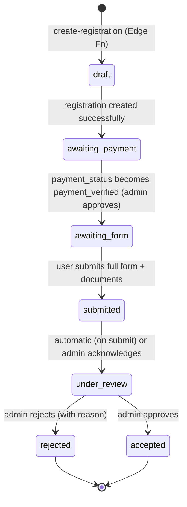
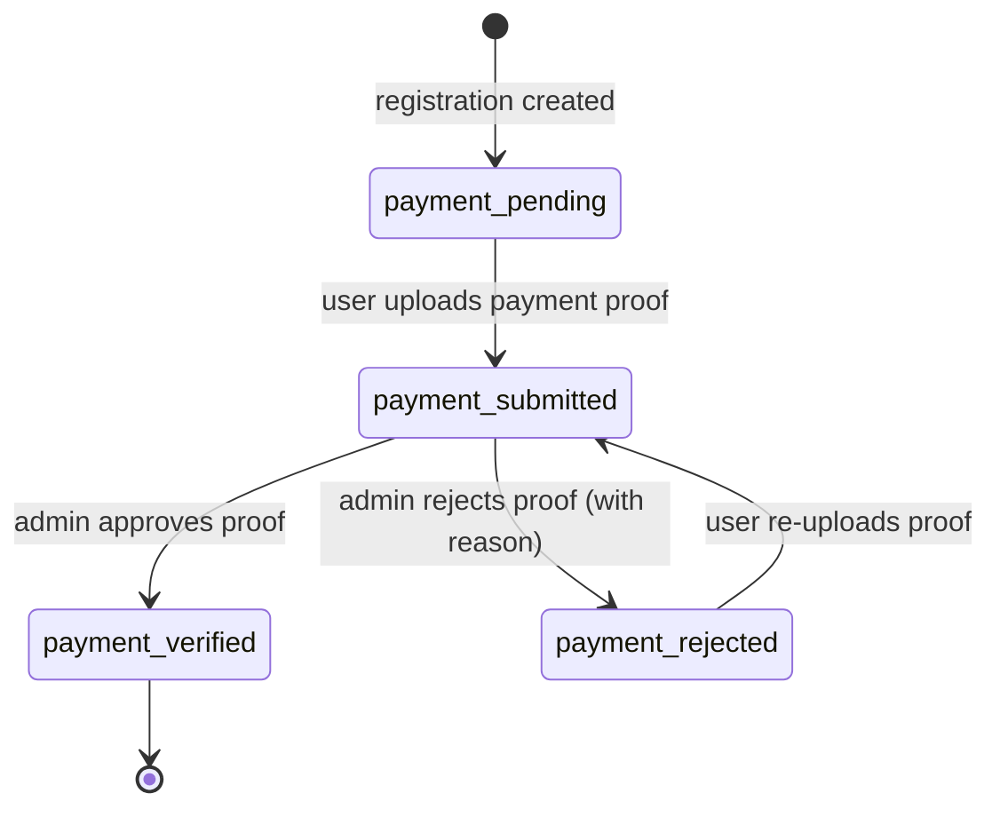

# 05 — Business Workflows

## 1. State Machines

### 1.1 Registration Status State Machine



**Transition actors:**
| Transition | Triggered by |
|---|---|
| `[*] → draft` | Edge Function `create-registration` |
| `draft → awaiting_payment` | Immediate — same Edge Function response |
| `awaiting_payment → awaiting_form` | Admin (payment verification approval) |
| `awaiting_form → submitted` | User (full form submission) |
| `submitted → under_review` | Automatic on submission / Admin acknowledgement |
| `under_review → accepted` | Admin |
| `under_review → rejected` | Admin (must provide reason) |

---

### 1.2 Payment Status State Machine



**Transition actors:**
| Transition | Triggered by |
|---|---|
| `[*] → payment_pending` | Edge Function `create-registration` |
| `payment_pending → payment_submitted` | User (proof upload) |
| `payment_submitted → payment_verified` | Admin |
| `payment_submitted → payment_rejected` | Admin (must provide reason) |
| `payment_rejected → payment_submitted` | User (re-upload) |

---

## 2. State Transition Tables

### 2.1 registration_status

| From | To | Triggered by | Condition | Effect |
|---|---|---|---|---|
| *(initial)* | `draft` | Edge Function `create-registration` | Valid initial registration payload | Row created; `registration_number` + `access_code` generated |
| `draft` | `awaiting_payment` | Edge Function (same invocation) | Registration row persisted | `payment_status` set to `payment_pending` |
| `awaiting_payment` | `awaiting_form` | Admin (payment approval action) | `payment_status` = `payment_verified` | User may now access full form |
| `awaiting_form` | `submitted` | User (form submit) | All required fields + documents present | Form locked; admin notified |
| `submitted` | `under_review` | Automatic / Admin | Form submission received | Admin begins review |
| `under_review` | `accepted` | Admin | Admin approves registration | Final state; success notification shown |
| `under_review` | `rejected` | Admin | Admin rejects with written reason | Final state; reason stored |

**Forbidden transitions:**
- `draft → submitted` (must pass through payment verification)
- `awaiting_payment → submitted` (payment must be verified first)
- `accepted → *` (terminal — no transitions out)
- `rejected → *` (terminal — no transitions out; rejected registrants must start fresh)
- Any status → `draft` (no rollback to initial state)
- Skipping `under_review` (e.g., `submitted → accepted` directly) — not allowed without explicit admin review step

---

### 2.2 payment_status

| From | To | Triggered by | Condition | Effect |
|---|---|---|---|---|
| *(initial)* | `payment_pending` | Edge Function `create-registration` | Registration created | Awaiting user proof upload |
| `payment_pending` | `payment_submitted` | User (proof upload) | Valid image file uploaded to Storage | Proof URL saved; admin dashboard updated |
| `payment_submitted` | `payment_verified` | Admin | Admin confirms proof is valid | `registration_status` → `awaiting_form`; user may fill full form |
| `payment_submitted` | `payment_rejected` | Admin | Admin rejects proof (must provide reason) | Rejection reason stored; user notified via status page |
| `payment_rejected` | `payment_submitted` | User (re-upload) | User uploads new proof | Previous proof URL overwritten; rejection reason cleared |

**Forbidden transitions:**
- `payment_pending → payment_verified` (admin must see proof; cannot auto-verify)
- `payment_verified → *` (terminal — verified payments are not reversed)
- `payment_verified → payment_rejected` (no clawback after approval)
- `payment_submitted → payment_pending` (no rollback to unpaid)

---

## 3. Step-by-Step Business Workflows

### Workflow B — Initial Registration

1. User navigates to `/daftar`.
2. User fills the initial registration form:
   - Child's full name
   - Parent/guardian's full name
   - Parent/guardian's WhatsApp number
3. On submit, client calls Edge Function `create-registration` with the form payload.
4. Edge Function:
   a. Validates input (server-side).
   b. Generates a unique `registration_number` (format: `PPDB-YYYY-NNNN`, e.g., `PPDB-2026-0001`).
   c. Generates a cryptographically random `access_code` (e.g., 8-character alphanumeric).
   d. Hashes `access_code` before storing (store only the hash; return plain text once).
   e. Inserts a new row into `registrations` with `registration_status = awaiting_payment`, `payment_status = payment_pending`.
   f. Returns: `{ registration_number, access_code }` — **access_code is never returned again after this response**.
5. Client stores `registration_number` and `access_code` in component state (not localStorage by default).
6. Client redirects to `/daftar/pembayaran` carrying the returned values (via router state or query params).

> **Security note:** The plain-text `access_code` is returned exactly once. If the user closes the browser, they lose it. The WhatsApp message (Workflow E) is the recovery mechanism — users must send it to admin for manual assistance.

---

### Workflow C — Payment

1. User lands on `/daftar/pembayaran` with their `registration_number` visible.
2. Page displays:
   - Bank account info (hardcoded): Bank name, account number, account holder name.
   - Transfer amount: **Rp300.000**.
   - Instructions to include `registration_number` as transfer note/description.
3. User makes the bank transfer manually (outside the system).
4. User returns and uploads proof of transfer (image: JPEG/PNG, max 5MB).
5. Client uploads proof to Supabase Storage bucket `payment-proofs/<registration_number>/<filename>`.
6. Client calls Edge Function `submit-payment-proof` with `{ registration_number, access_code, proof_url }`.
7. Edge Function:
   a. Verifies `access_code` hash against stored hash.
   b. Confirms current `payment_status = payment_pending` or `payment_rejected`.
   c. Updates `payment_status → payment_submitted`, saves `proof_url`.
8. Admin receives new entry in the payment review queue on the dashboard.
9. Admin opens the payment detail page, views the uploaded proof image.
10. **If admin approves:**
    - `payment_status → payment_verified`
    - `registration_status → awaiting_form`
    - Audit log entry created.
11. **If admin rejects:**
    - `payment_status → payment_rejected`
    - `rejection_reason` (text) saved.
    - Audit log entry created.
    - User sees rejection reason on status page and may re-upload (see Error Handling §4.1).

---

### Workflow D — Full Form

1. User navigates to `/daftar/formulir` and enters `registration_number` + `access_code`.
2. Edge Function `verify-registration-access` validates credentials and confirms `registration_status = awaiting_form`.
3. If not `awaiting_form`, access is denied with a status-appropriate message (e.g., "Pembayaran belum diverifikasi").
4. Full form is displayed (fields TBD — see separate data schema spec).
5. User fills all required fields and uploads required documents to Supabase Storage.
6. On submit, Edge Function `submit-full-form` is called:
   a. Validates all required fields and document URLs present.
   b. Updates `registration_status → submitted`.
   c. Locks the form (read-only from this point).
7. User is redirected to `/daftar/berhasil`.

---

### Workflow E — Success / WhatsApp Handoff

1. On `/daftar/berhasil`, the system displays:
   - Registration number
   - Access code (retrieved from component state — it was set at creation time)
   - A link to the status check page (`/status?r={registration_number}`)
   - A **WhatsApp button** (wa.me link)
2. The wa.me link is constructed as:
   ```
   https://wa.me/6282169599979?text={encodeURIComponent(message)}
   ```
   Where `{message}` is the template defined in §5.
3. Clicking the WhatsApp button opens WhatsApp (web or app) with the message pre-filled.
4. **The user must press "Send" manually** — the system does not send any message automatically.
5. The page includes a prominent note: *"Simpan nomor pendaftaran dan kode akses Anda sebelum menutup halaman ini."*

> **Important:** There is no SMS, email, or automated WA notification in this system. The wa.me link is the only distribution mechanism. If the user closes the page without sending the message, they must contact admin via manual WhatsApp.

---

### Workflow F — Status Check

1. User navigates to `/status`.
2. User enters `registration_number` and `access_code`.
3. Client calls Edge Function `verify-registration-access` with both values.
4. Edge Function:
   a. Looks up the registration by `registration_number`.
   b. If not found → returns opaque error (identical response to wrong code — see §4.2).
   c. Compares `bcrypt/argon2` hash of provided `access_code` against stored hash.
   d. If mismatch → returns same opaque error. Increments failed attempt counter.
   e. If matched → returns **only the following fields**:
      - `registration_status`
      - `payment_status`
      - `payment_rejection_reason` (only if `payment_status = payment_rejected`)
      - `form_completeness_indicator` (boolean or percentage — not raw form data)
5. Status page renders a read-only view using the returned fields.
6. **The Edge Function NEVER returns:** documents, full form data, parent contact info, proof URLs, or the `access_code` hash.

---

### Workflow G — Admin Flows

1. **Login:** Admin navigates to `/admin/login`. Signs in via Supabase Auth (email + password). On success, redirected to `/admin`.
2. **Dashboard overview:** Displays aggregate counts by `registration_status` and `payment_status`. Lists recent registrations requiring action.
3. **Payment review:**
   a. Admin selects a registration from the queue.
   b. Navigates to `/admin/pendaftar/:id`.
   c. Views proof image, registrant name, `registration_number`, transfer amount.
   d. Admin clicks **Setujui** (Approve) or **Tolak** (Reject).
   e. If rejecting, admin must enter a `rejection_reason` (required field).
   f. Action calls server-side function (RPC or Edge Function) that transitions statuses.
4. **Status management:** Admin may manually move `registration_status` in permitted directions (e.g., `submitted → under_review → accepted/rejected`) from the detail page.
5. **Audit log:** Every admin action (approval, rejection, status change) is written to an `audit_log` table with: `actor_id`, `action`, `target_registration_id`, `old_status`, `new_status`, `notes`, `created_at`.

---

## 4. Error Handling

### 4.1 Payment Proof Re-upload After Rejection

- Status page shows `payment_status = payment_rejected` and the `rejection_reason`.
- A **Re-upload** button is shown on the payment page (or status page with a deep link to payment page).
- User navigates back to `/daftar/pembayaran`, re-enters credentials, uploads a new proof.
- The Edge Function `submit-payment-proof` accepts re-upload only when current `payment_status = payment_rejected`.
- The old proof file in Storage is overwritten (or archived — implementation decision).
- `payment_status` reverts to `payment_submitted`; `rejection_reason` is cleared.

### 4.2 Wrong Access Code / Non-existent Registration Number

- The Edge Function `verify-registration-access` **always returns the same opaque error** for:
  - Wrong `access_code`
  - Non-existent `registration_number`
- Error response: `{ error: "Nomor pendaftaran atau kode akses tidak valid." }` — HTTP 401.
- This prevents enumeration attacks (attacker cannot distinguish "number not found" from "wrong code").
- **Rate limiting:** Implement per-IP (or per-`registration_number`) rate limiting on the Edge Function:
  - After 5 failed attempts within 15 minutes → HTTP 429 with `Retry-After` header.
  - Failed attempt counter stored in Supabase (e.g., `access_attempts` table) or a Redis-compatible store.
- Locked-out users must wait out the rate limit window. No unlock mechanism is provided (admin can assist manually via WhatsApp).

### 4.3 Registration Number Does Not Exist (Confirm-Existence Prevention)

- See §4.2 — the same opaque error is returned.
- The UI message must not differentiate between "not found" and "wrong code". Use: *"Nomor pendaftaran atau kode akses tidak valid."*

---

## 5. WhatsApp Message Template

Exact message pre-filled in the wa.me link (before URI encoding):

```
Pendaftaran berhasil!

Nama: {child_name}
Nomor Pendaftaran: {registration_number}
Kode Akses: {access_code}

Silakan periksa status pendaftaran melalui link berikut:
{status_page_url}

Simpan nomor pendaftaran dan kode akses ini untuk memeriksa status pendaftaran Anda.
```

**Variable substitutions:**
| Variable | Value |
|---|---|
| `{child_name}` | Child's full name as entered in the registration form |
| `{registration_number}` | Generated registration number, e.g. `PPDB-2026-0001` |
| `{access_code}` | Plain-text access code returned at creation (8-char alphanumeric) |
| `{status_page_url}` | Full URL, e.g. `https://ppdb.taud-abu-ayyub.sch.id/status?r=PPDB-2026-0001` |

**wa.me link construction:**
```
https://wa.me/6282169599979?text=<encodeURIComponent(message)>
```

Admin WhatsApp number: `6282169599979` (no `+` prefix in wa.me links).

> **Note:** Clicking the link opens WhatsApp Web or the WhatsApp app with the message pre-filled in the compose box. The user must press the **Send** button manually. The system does not send the message automatically.
